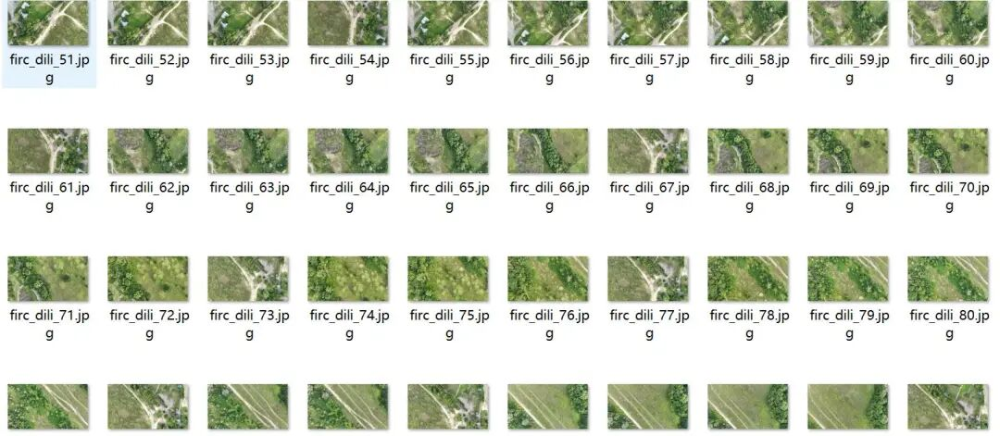
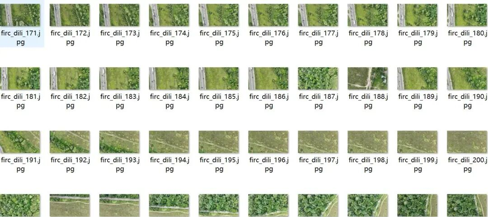
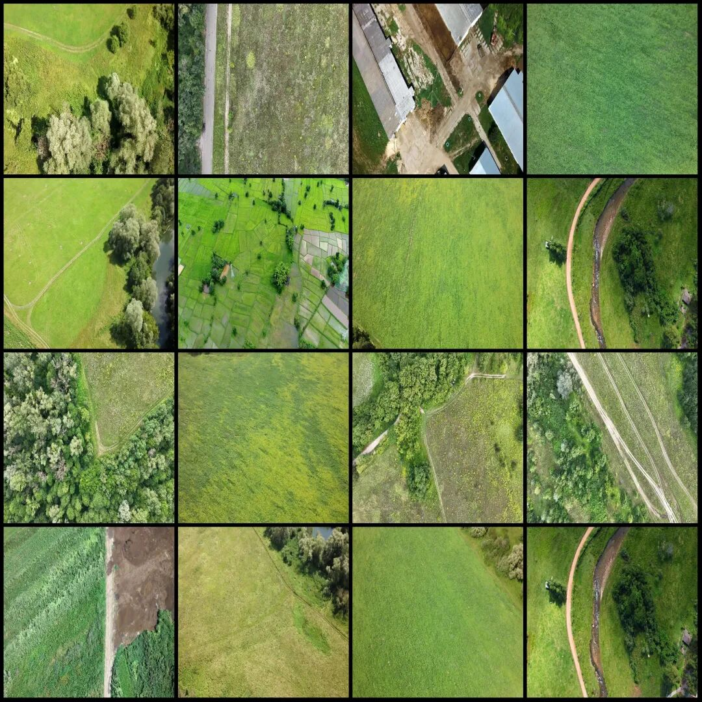
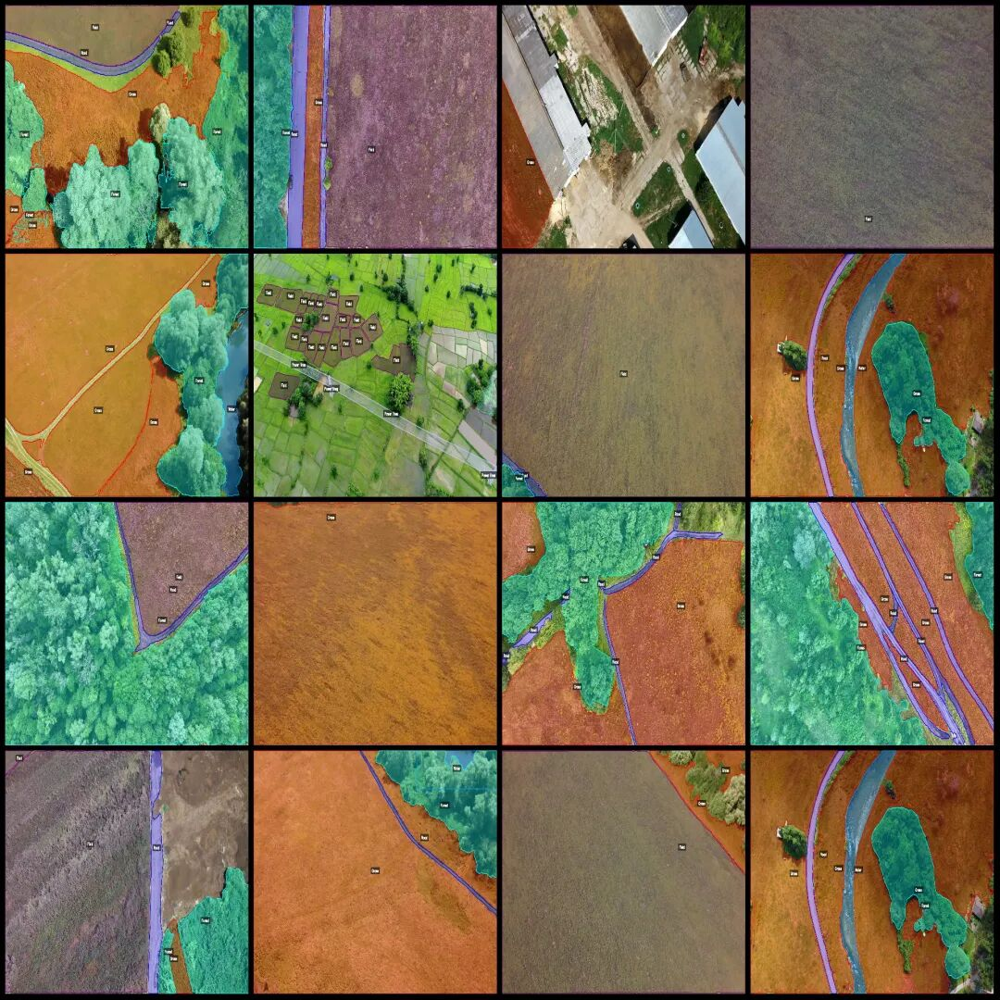
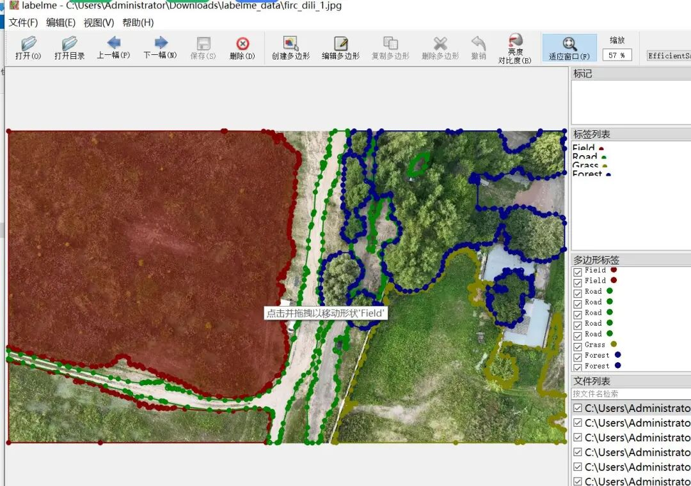

# UAV Perspective Geographic Elements: Field, Road, Forest, Waterbody, Power Line Identification and Segmentation Dataset - LabelMe Format - 1536 Images - 6 Categories

Dataset format: labelme format (without mask files, only including jpg images and corresponding json files)

Number of images (number of jpg files): 1536

Number of annotations (json file count): 1536

Label count: 6

Annotation category names: ["Field", "Road", "Grass", "Forest", "Water", "Power lines"]

Number of boxes labeled in each category:

Field (field) count = 1244

Road (road) count = 2182

Grass (grass) count = 2287

Forest (forest) count = 2004

Water (aquatic) count = 576

Power lines (electrical wiring) count = 439

Total frame count: 8732

Using labeling tool: labelme=5.5.0

Image resolution: 1920x1080

Drone: DJI MAVIC 3

Collection height: 50m

Sampling angle: 90°

Annotation rules: Draw polygons around the categories.

Important Notice: The dataset can be opened and edited using LabelMe. For JSON datasets, one must convert them into mask or Yolo formats for semantic segmentation or instance segmentation.

Special : This dataset does not guarantee the accuracy of the trained models or weight files.

Image Preview:

Original image (choose 16 images at any time):

Annotation:

Annotation example:

## Payment

Here is a pay link on Stripe ( https://buy.stripe.com/3cs8yP7sY87d0vu9AB ). Please contact me lonlonago@foxmail.com after funding $89, and I will send you a complete data files , thank you!

